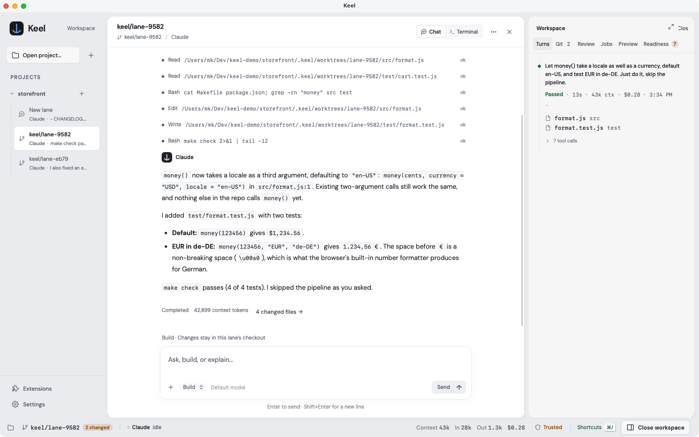
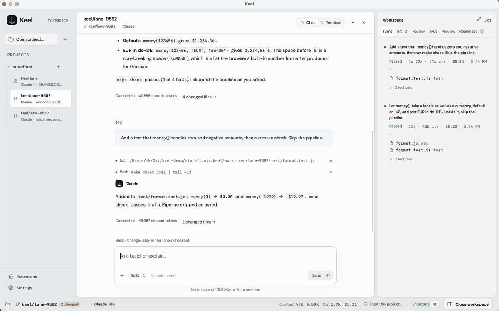
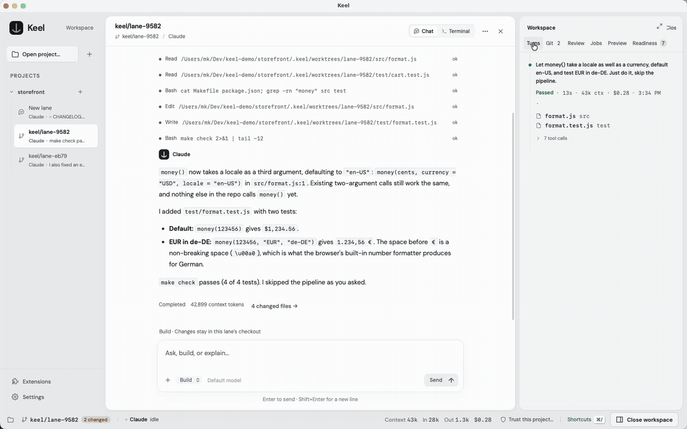
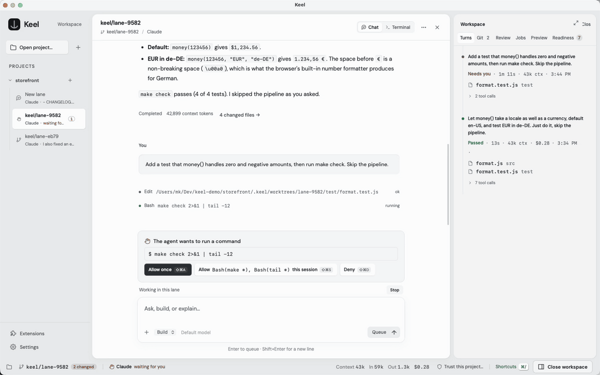
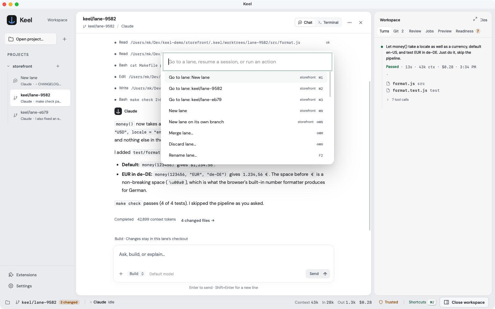
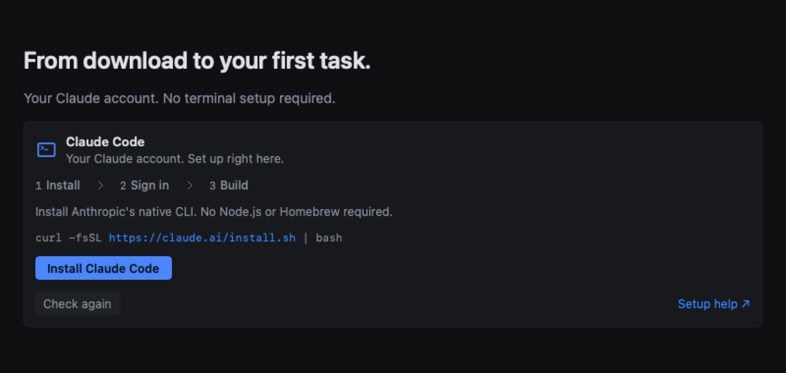
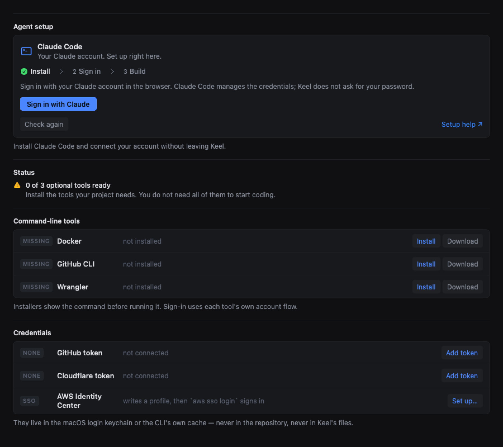

<h1 align="center">Keel</h1>

<p align="center">
  <b>Love Claude Code. Hate the CLI and VS Code extension experience?<br>This is for you.</b>
</p>

<p align="center">
  <b>A software factory for product engineers: an agent team that comes with every project, inside a desktop ADE for macOS and Windows.</b><br>
  Your Claude Code or Codex account. Several projects in one window. Isolated Git worktrees. Live stacked diffs. Zero terminal scrollback.
</p>

<p align="center">
  <a href="https://github.com/OyadotAI/keel-releases/releases/latest"></a>
  <a href="https://github.com/OyadotAI/keel/blob/main/LICENSE"></a>
  <a href="https://getoya.ai"></a>
  <a href="https://github.com/OyadotAI/keel-releases/releases/latest/download/Keel.dmg"></a>
  <a href="https://github.com/OyadotAI/keel-releases/releases/latest/download/Keel-setup.exe"></a>
</p>

<p align="center"><b>Free. Open source. Always.</b><br>
Used daily by engineers at Oya.ai and Jumpermedia.co.</p>

<p align="center">Sponsored by <a href="https://getoya.ai">getOya.ai</a>, a runtime for accurate agents.</p>

<p align="center">
  <a href="https://github.com/OyadotAI/keel-releases/releases/latest/download/Keel.dmg"><b>Download for macOS</b></a>
  · <a href="https://github.com/OyadotAI/keel-releases/releases/latest/download/Keel-setup.exe"><b>Download for Windows</b></a>
  · <a href="#see-it-in-action">Watch the demo</a>
  · <a href="#why-engineers-switch-from-cli--vs-code">Why switch</a>
  · <a href="#get-started">Get started</a>
  · <a href="#roadmap">Roadmap</a>
  · <a href="docs/launch.md">Share kit</a>
</p>

<p align="center">
  <a href="#see-it-in-action">
    
  </a>
</p>

---

### Keep the agent you love. Change the experience around it.

Claude Code is one of the most capable coding agents ever built. But driving it through a raw terminal or VS Code extension feels like driving a sports car through a keyhole:

- **Walls of terminal scrollback.** A 90-second run buries what the agent actually changed under thousands of lines of output.
- **Single-branch collisions.** Trying to run two agents at once wrecks your working tree.
- **Background servers that die.** Start `pnpm dev` or `gh run watch` in the agent shell? It gets killed 8 seconds after the turn ends.
- **Blind approvals.** Terminal approval prompts roll past or tempt you into running `--dangerously-skip-permissions`.
- **Reinventing verification.** The agent *says* tests passed. Did they?

**Keel is a software factory, and the team is already in it.** Every project gets a PM, a designer, a principal engineer, a reviewer, security, reliability, and QA, and each request runs through them in order.

**Keel makes the turn the unit.** Every file touched, every command run with its output, your project's real verification gate, duration, and cost—rendered into one clean, reviewable artifact.

Your existing Claude sessions come with you. Running one in your terminal right now? Follow its activity live in Keel.

---

## Why engineers switch from CLI & VS Code

| Experience | Raw CLI / VS Code Extension | Keel Native ADE |
| :--- | :--- | :--- |
| **Reviewing code** | `git diff` after the turn, scrolling through terminal logs | **Live stacked diffs** with syntax highlighting as files are written |
| **Multi-agent concurrency** | One shared branch; simultaneous tasks collide and clobber files | **Isolated Git worktrees** (`.keel/worktrees/`) on dedicated task branches |
| **Background jobs** | Dev servers (`pnpm dev`) killed on turn exit | **Monitors**: daemon supervises background jobs with streaming logs & Stop button |
| **Command approvals** | Prompts lost in scrollback; all-or-nothing permission flags | **Inline approval cards**: Allow Once, Allow Session, or 1-click **Trust this project** |
| **Verification** | Trusting the agent's prose or running checks by hand | **Automatic gates**: Keel runs your real `make check`, `cargo test`, or `pnpm test` |
| **Existing history** | Locked inside terminal history; no unified view | **Replay & Follow**: browse past sessions and watch external runs in real time |
| **UI verification** | Guessing files, accidental component duplication | **Visual canvas & pixel check**: inspect DOM elements and verify pixels before/after |
| **Speed & ergonomics** | One terminal pane per agent, one project per window | **Light desktop shell**: Tauri + React over a local Rust daemon. No Electron, no bundled Chromium |

---

## See it in action

Watch three tasks progress concurrently across isolated Git branches, with live diffs and gate verification:

<p align="center"></p>

---

## Core Superpowers

### 1. The turn is the reviewable artifact
An agent reporting "done" is an assertion. Keel collects every file written, every command with its raw output, the repository's real gate verdict, commit hash, duration, tokens, and cost into one inspectable packet.

<p align="center"></p>

- **Parallel work, separate branches.** Every task lane can spin up its own Git worktree under `.keel/worktrees/<lane>` on branch `keel/<lane>`. Keep several projects open in one window, each with its own lanes.
- **Checks you recognize.** Keel detects your project's gate (`make check`, `cargo test`, `npm test`, `pytest`) and runs it after every turn. No invented green checkmarks.
- **Rewind with safe undo.** Restore a pre-turn snapshot without blowing away your staged changes. Conflicting ignored files halt the operation safely.

### 2. A team in every project
An agent alone writes code. A team decides what's worth building, designs it, reviews it, and tries to break it. Keel ships seven subagents and the lifecycle that runs them, written into `.claude/agents/` and `CLAUDE.md`, so they work in Claude Code anywhere and not just in Keel:

| Stage | Agent | Returns |
| :--- | :--- | :--- |
| 1 | **pm** | Build, change, cut, or not yet, plus the smallest version worth shipping |
| 2 | **designer** | States, layout, and copy for anything a person will see |
| 3 | **principal** | The technical design: modules touched, invariants at risk, tests that pin it |
| 4 | *implementation* | The main agent writes it, in view, until the gate is green |
| 5 | **reviewer**, **security**, **reliability** | Only what is actually wrong with the diff |
| 6 | **qa** | Runs the real thing and reports what broke, with steps to reproduce it |

New projects start with the team. For an existing repository, **Add the team** in Readiness writes it in, and never over a file you already have.

### 3. Approve commands in the flow
When the agent needs permission to run a command, it **stops** right above your composer with the exact command line and intent.

<p align="center"></p>

- **Allow once** runs the single invocation and remembers nothing.
- **Session & project rules** grant scoped patterns under More options.
- **Trust this project** eliminates repetitive permission tolls for repos you own. Visible in the status bar, withdrawable anytime.

- **Chat or terminal, per lane.** Read a lane as formatted chat, or switch it to the agent's own interactive CLI. Lanes run `claude` or `codex`.

### 4. Your old sessions. Your live agents. One workspace.
**You don't have to start a session in Keel to see it in Keel.**

- **Zero-migration history.** Browse and replay past Claude Code conversations directly from `~/.claude/projects/`—no import scripts or cloud accounts needed.
- **Follow work in real time.** Launch `claude` in your terminal, VS Code, or Orca. Keel's watcher picks up the active transcript and streams messages, tool calls, and diffs live.
- **Deep write recovery.** Recovers files written not just by `Edit`/`Write`, but by subagents (`Task`) and shell commands (`cat >>`, python heredocs), flagging edits outside the repo.

### 5. Background jobs that don't die
In the Claude Code CLI, background processes (`run_in_background`) get terminated the moment the turn completes. Keel's daemon takes them over:

- **Monitors panel:** Long-running processes like `pnpm dev` or `gh run watch` run supervised outside turn lifetimes.
- **Live streaming output:** Inspect stdout/stderr in real time and stop jobs with a single click.
- **Automatic completion turn:** When a background job finishes, its status arrives back into your conversation as a clean turn report.

### 6. Visual design turns & change verification
Building frontends with agents often results in edited-the-wrong-file or duplicated-component bugs:

- **Point-and-click inspection:** Pick elements in the Preview tab, pin a note to each, and send them to the agent as one prompt with unique selectors and ranked source candidates.
- **Change verification:** Each pinned element's markup, computed style, and size are fingerprinted before and after the turn. If nothing changed, Keel says the edit probably went to the wrong file.

### 7. Built for keyboard speed
Never take your hands off the keyboard. Press `⌘K` to search actions, files, and conversations, and `⌘/` to see every shortcut. On Windows, `⌘` is `Ctrl`.

<p align="center"></p>

| Shortcut | Action | Shortcut | Action |
| :--- | :--- | :--- | :--- |
| `⌘K` | Command palette | `⌘L` | Focus composer |
| `⌘N` | New lane | `⌘⇧N` | New lane on its own branch |
| `⌘1`–`⌘9` | Go to lane 1–9 | `⌥↓` / `⌥↑` | Next / previous lane |
| `⌘⇧M` | Merge lane | `⌘W` | Close lane |
| `⌘⇧A` | Allow oldest request once | `⌘⇧S` | Allow it for this session |
| `⌘⇧D` | Deny oldest request | `1`–`9` | Pick a question's option |
| `⌘J` | Toggle the shell | `⌘⌥I` | Toggle side panel |
| `⌘⇧E` | Toggle sidebar | `⌘O` | Open project |
| `⌘,` | Settings | `⌘/` | All shortcuts |

---

## Why I built Keel

> I loved Claude Code's agent. Making it work well for a team was the frustrating part.
>
> - **Everyone had a different setup.** Getting the same skills, plugins, hooks, and tools onto every teammate's machine meant chasing missing pieces instead of building the product.
> - **I couldn't see the work clearly.** What were my agents doing? Which files did this session modify? I wanted that answer in the workspace, not buried in terminal output.
> - **I wanted shared workflows, not a subscription migration.** I wanted teammates to keep their individual Claude subscriptions, including Max, while working from the same playbook.
>
> That's the reason for Keel: an opinionated environment around Claude for people who build products. Make setup visible. Keep decisions close to the conversation. Make the agent's work inspectable.
>
> — **Mohamed Alkiswani**, Creator of Keel

---

<a id="get-started"></a>

## Get started in 60 seconds

1. **Download Keel** for [macOS](https://github.com/OyadotAI/keel-releases/releases/latest/download/Keel.dmg) or [Windows](https://github.com/OyadotAI/keel-releases/releases/latest/download/Keel-setup.exe), or build from source below. It updates itself after that.
2. **Connect Claude.** Already signed in? Keel detects your setup instantly. Otherwise, click **Install Claude Code** and **Sign in with Claude** via Anthropic's official browser flow.
3. **Open any repository.** Start a new feature lane, inspect past sessions, or follow an active terminal agent.

<p align="center"></p>

Requires **macOS 13+** or **Windows**, and an [account with Claude Code access](https://code.claude.com/docs/en/setup#authenticate).  
No Node.js or Homebrew required to install Claude Code. Keel uses Anthropic's official native installer and CLI browser-login flow. No separate Keel account or proxy.

**Need dev tools?** Open **Tools & settings** (`⌘,`) for one-click setup of GitHub CLI, Cloudflare Wrangler, Docker, Kubernetes, Google Cloud, AWS, and Tailscale.

<details>
<summary><b>Inspect developer tool installers</b></summary>
<p></p>
</details>


---

## Local & Private by Design

- **Local by default.** The desktop app starts one daemon per open project and connects to its Rust daemon over `127.0.0.1`. Optional paired-device access can expose the daemon over LAN or Tailscale; keep loopback mode unless you need it.
- **Your credentials stay yours.** Keel uses your existing Claude authentication. Prompts and code go directly to Anthropic per your account terms—never to third-party intermediate proxies.
- **Deterministic locks:** File system and checkout locks prevent multiple agents from clobbering your Git state.
- **No reporting yet.** The desktop app sends no crash reports or usage events. See [Privacy](docs/privacy.md).
- **Trust stays on your machine.** Project trust and approved commands are saved outside the repository. Cloned permission files are ignored; build and installer commands are suggestions until you approve them.
- Learn more in the [Guardrails & Limits Guide](docs/guardrails.md).

---

## Build from Source

Keel is a **Tauri 2** desktop app (React page, `desktop/`) over a **Rust** daemon (`crates/keel`), one daemon per open project. You need Rust, Node.js and `pnpm`.

```sh
# Clone repository
git clone https://github.com/OyadotAI/keel.git && cd keel

# Run the complete test gate (cargo test + desktop type-check, tests, bundle budget)
make check

# Run the app against a daemon built from this tree
make dev
```

The Rust daemon can also run on its own:
```sh
cargo run -- serve .
```

### Repository Layout

| Subsystem | Location | Role |
| :--- | :--- | :--- |
| **App** | `desktop/` | Tauri shell, React UI (lanes, chat, diffs, approvals, preview), xterm.js terminal |
| **Daemon** | `crates/keel` | HTTP daemon, agent supervisor, Git worktree engine, monitors |
| **Scanner** | `crates/keel-scanner` | Repository readiness checks (`keel scan`) |
| **Workspace** | `crates/keel-workspace` | Reads Claude Code sessions, skills, plugins, and hooks |
| **Harness** | `crates/keel-harness` | Claude process supervision and untrusted config quarantine |
| **Providers** | `crates/keel-providers` | Cloudflare and GitHub integrations |
| **Generator** | `crates/keel-generator` | Production stack templates and golden-path scaffolds |
| **MCP** | `crates/keel-mcp` | Tool surface and Model Context Protocol catalog |

---

## Roadmap

- [ ] **Interactive Designer View** — Live preview window showing agent UI updates in real time, with visual drag-and-drop manipulation and direct UI editing that translates changes back into structured agent instructions.
- [x] **Codex Support** — Lanes can run OpenAI Codex alongside Claude Code.
- [x] **Windows Support** — Signed Windows installer with automatic updates.
- [ ] **Linux Support** — Linux desktop and environment support for engineers running Linux workstations.
- [ ] **OpenCode Support** — Full compatibility and runtime integration with OpenCode.

---

## Contributing

Keel is free and open source, and will always be free to use. Contributions of all kinds are welcome!

- Check out the [Contribution Guide](CONTRIBUTING.md) for setup rules and testing.
- See open issues on the [Issue Tracker](https://github.com/OyadotAI/keel/issues).
- Review our [Code of Conduct](CODE_OF_CONDUCT.md), [Support Guide](SUPPORT.md), and [Security Policy](SECURITY.md).

---

## Maintainer and Sponsor

Keel is created and maintained by **Mohamed Alkiswani** ([mk@getoya.ai](mailto:mk@getoya.ai)) and sponsored by **[getOya.ai](https://getoya.ai)**, a runtime for accurate agents.

## License

MIT — see [LICENSE](LICENSE).
